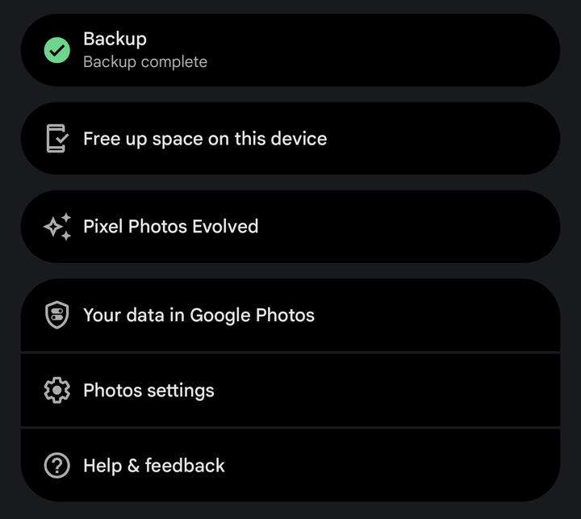
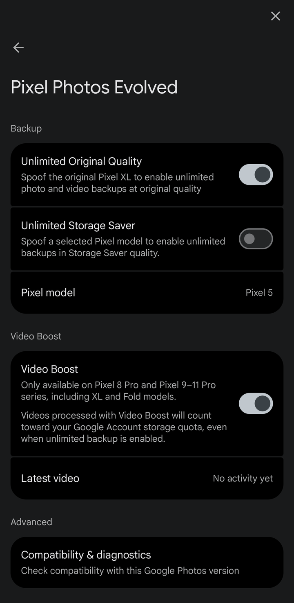
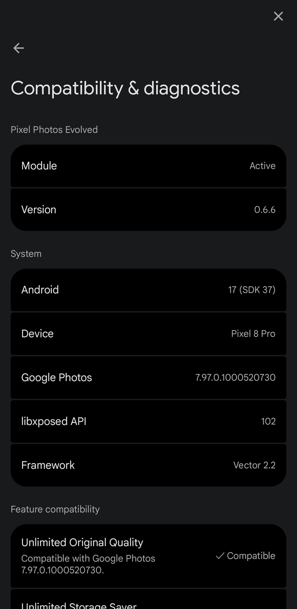
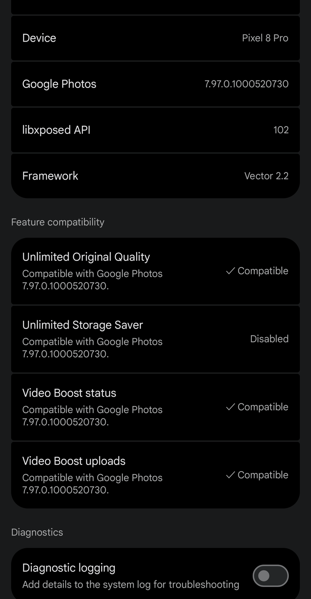

# Pixel Photos Evolved

**Backup and Video Boost controls for Google Photos, in Google Photos itself.**

Google Photos → your profile picture → **Pixel Photos Evolved**.

 

---

> [!NOTE]
> **Tested with Google Photos 7.97.0.1000520730 (`52549361`) on Android 17 QPR1, build
> `CP3A.261005.005`, Pixel 8 Pro, Vector 2.2 / libxposed API 102.** Hooks are pinned to this
> Photos build. On any other build, Photos keeps its own behaviour and
> **Compatibility &amp; diagnostics** shows what is unavailable.

> [!IMPORTANT]
> Google decides backup eligibility and how storage is counted, on its servers. This module
> changes what Google Photos on this phone reports. It cannot promise unlimited storage, and
> using it may conflict with Google's terms of service. Check your account storage after
> enabling any backup option.

<table>
<tr>
<td width="33%" align="center" valign="top"> Its own card in the profile menu</td>
<td width="33%" align="center" valign="top"> Drawn like Google Photos settings</td>
<td width="33%" align="center" valign="top"> Compatibility &amp; diagnostics</td>
</tr>
</table>

## Why it works this way

Most modules hand you a second settings app. This one has none: no launcher icon and no settings
activity. Its page opens from its own card in the Google Photos profile menu, above
**Your data in Google Photos** and separate from it. It uses Photos' own fonts, colours, switches
and motion, and stores its settings in Photos' own data directory.

|  | |
|---|---|
| 🧭 **Where you already are** | Profile picture → Pixel Photos Evolved. Back returns to the menu. |
| 🎨 **Looks like Photos** | Photos' type scale, card colours, Material switch and its emphasized easing for page transitions. Light and dark themes follow Photos. |
| 🛡 **Knows the Photos it runs in** | Every hook is checked against the running Photos build before it is installed. A missing or changed hook disables only its own feature. |
| 🧠 **Policy in Brainfuck** | Backup and Video Boost decisions run as a compiled Brainfuck program (ARM64), called with a small fixed ABI. |
| 🎞 **Media untouched** | Photos and videos are never renamed, rewritten, re-encoded or deleted. |
| 🔒 **Scoped** | Only `com.google.android.apps.photos`. No system-wide hooks, no root needed by the module. |

---

## Features

<b>☁️ Backup</b>

 

| Setting | What it does |
|---|---|
| **Unlimited Original Quality** | Applies a Pixel XL (2016) identity inside Google Photos, so Photos offers the Pixel XL backup terms. Your phone's own editing features stay available. |
| **Unlimited Storage Saver** | Applies the identity of a selected older Pixel instead. It and Unlimited Original Quality turn each other off. Photos only honours it with backup quality set to Storage saver. |

Identity changes apply when Google Photos starts: force-stop and reopen Photos after changing them.

<b>🎬 Video Boost</b>

 

| Setting | What it does |
|---|---|
| **Video Boost** | Detects Video Boost recordings and uploads them with the phone's real identity, so Google can process them while other backups keep the backup identity. Only on phones that record Video Boost: Pixel 8 Pro and the Pixel 9–11 Pro series, including XL and Fold models. |
| **Latest video** | The last Video Boost state Photos reported: waiting to upload, uploading, processing, ready to play or failed. |

Videos processed with Video Boost count toward your Google Account storage, even when an
unlimited backup option is on. See [Video Boost](docs/VIDEO_BOOST.md) for how an upload is
recognised and routed.

---

## Compatibility

**Tested on** (anything else is untested, not unsupported):

| Device | Android build | Google Photos | Checked | Not yet checked |
|---|---|---|---|---|
| Pixel 8 Pro | CP3A.261005.005 (Android 17) | 7.97.0.1000520730 / 52549361 | profile-menu card, settings page, diagnostics, Back from every page, light and dark themes, 130% text (0.6.3), backup probe, Video Boost manual and automatic uploads (0.6.1) | TalkBack end to end, rotation, other Photos builds, other devices |

- **Version gate.** At start the module checks the Photos version, Android API level and ABI.
  An unknown combination installs nothing that changes behaviour.
- **Per-feature hooks.** Backup and Video Boost hooks are found and checked separately. If one is
  missing, its row in diagnostics says *Not compatible with Google Photos …* and the other keeps
  working.
- **Compatibility &amp; diagnostics** shows the module version, Android, device, Google Photos
  version, libxposed API and framework, and each feature as compatible, disabled or unavailable.
  **Diagnostic logging** adds detail to `adb logcat -s PixelPhotosEvolved`.

<table>
<tr>
<td align="center"> Module and system</td>
<td align="center"> Feature compatibility</td>
</tr>
</table>

---

## Requirements

- Android 17 (API 37), ARM64. The APK installs from Android 13, but the hooks only switch on for
  the tested Android and Photos versions
- An Xposed framework with **libxposed API 102** (tested with Vector 2.2)
- Google Photos 7.97.0.1000520730 for the pinned hooks

## Install

1. Install the [development APK](module/pixel_photos_module-signed.apk).
2. Enable **Pixel Photos Evolved** in your Xposed manager, scoped to **Google Photos**
   (`com.google.android.apps.photos`).
3. Force-stop Google Photos and open it again.
4. Profile picture → **Pixel Photos Evolved**.

To turn it off, disable the module in your Xposed manager and restart Google Photos. More in
[installation and troubleshooting](docs/INSTALLATION_AND_TROUBLESHOOTING.md).

> [!WARNING]
> The APK is signed with XAX's **public test key**. It is a development build, not a release.

## How it works

| Piece | Where | What it does |
|---|---|---|
| Module | [module/pixel_photos_module.xax](module/pixel_photos_module.xax) | Canonical XAX store: lifecycle, hooks, settings UI and diagnostics, lowered to DEX by the XAX android-libxposed target |
| Policy | [policy/](policy/) | Brainfuck policy compiled by BBC to BFX, imported into XAX and built as an ARM64 stdio executable ([ABI](policy/ABI.md)) |
| Policy host | [module/policy_process.xax](module/policy_process.xax) | The ARM64 executable packaged as `lib/arm64-v8a/libppepolicy.so`. It is run through stdio and is not a JNI library |
| Resources | [module/res/](module/res/) | Label, description and the adaptive icon |

## Build

Only Brainfuck and canonical XAX are source code in this repository. The build uses the XAX SDK
pinned in [toolchain.lock.json](toolchain.lock.json); conventional build tooling stays outside
the repository. [Reproducing a build](docs/REPRODUCE.md) covers the exact steps: verify the
stores, build the policy executable and module APK with XAX, add the resources with aapt2, sign.
[SHA256SUMS](SHA256SUMS) lists every retained file.

## Evidence

[Status](report/STATUS.md) separates what was checked on the device, what was checked offline and
what is untested. [Evidence index](docs/EVIDENCE.md) links every report.

## Credits

- [XAX](https://github.com/MrxSiN/XAX) — language, semantic store and Android target
- [BBC](https://github.com/MrxSiN/BBC) — Brainfuck compiler
- [Pixelify Google Photos](https://github.com/samson910022/pixelify-google-photos-modern) — device profiles and feature references
- [libxposed](https://github.com/libxposed/api) and Vector

See [attribution](docs/ATTRIBUTION.md). Pixel Photos Evolved is not affiliated with or endorsed by
Google. Google Photos and Pixel are trademarks of Google LLC.
