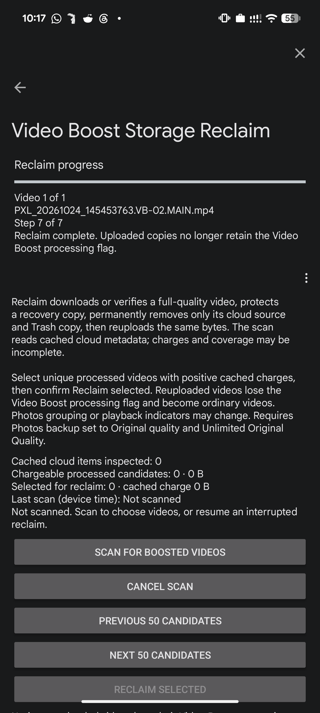
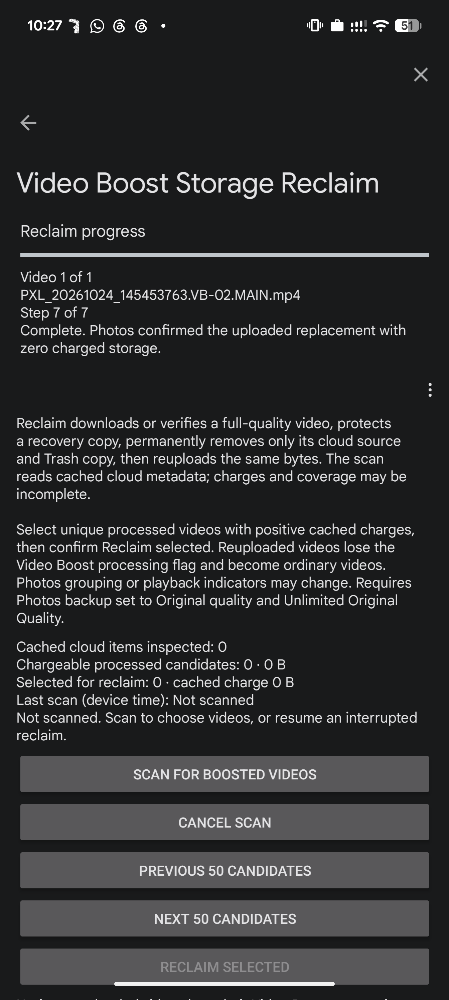

# Video Boost Storage Reclaim

Development build **1.2.1-dev / 27** implements the automatic selected-video process:
download → protect a verified recovery copy → delete the cloud original → permanently
delete only its matching Trash item → reupload the same bytes as an ordinary backup.

**Reuploaded videos lose their Video Boost processing flag.** Google Photos grouping,
playback indicators and processing-state labels may change. The video is not re-encoded.
The notice appears on the feature page and again before confirming permanent deletion.

## Use

1. Enable PPE and **Unlimited Original Quality**, restart Photos, and enable Photos
   backup with its backup quality set to **Original quality**.
2. Open Photos → profile picture → Pixel Photos Evolved → **Video Boost Storage Reclaim**.
3. Press **Scan for boosted videos**. This reads the active account's existing cloud
   metadata cache; opening the page does not start a scan or refresh the full library.
4. Select processed videos with positive cached charges. Remote aliases with the same
   content identity appear once and share one selection. **Reclaim selected** enables
   when at least one selectable video is checked. Sort, filter and bulk selection remain
   available; only 50 rows are displayed per page.
5. Press **Reclaim selected**, review the permanent-deletion and processing-flag notice,
   then confirm **Reclaim**. Work runs off the UI thread, one logical video at a time.
6. Follow **Reclaim progress**: the seven-step stage bar, current file and live copy/upload
   bytes. Waiting operations show an indeterminate bar and elapsed time.
7. Keep Photos running and online. **Pause reclaim** stops at a safe checkpoint.
   After an interruption, return to this page and choose **Resume reclaim** with the
   original account active. Completed items are removed from the current selection.

The summary separates file size from cached charged storage. Cached charges are estimates,
not a promise of recovered quota. Zero/unknown-charge records are not selectable.

## Implemented workflow

The Photos/API/ABI gate remains pinned to Photos **7.97.0.1000520730 / 52549361**,
Android API 37, ARM64. Account lookup uses Photos' native account service. Metadata reads
use the existing account database with Android SQLite **OPEN_READONLY**; PPE does not
write Photos' database or extract account credentials.

The scanner pages through `remote_media` in batches of 200, retaining at most roughly
2,000 candidates (the limit is checked after each batch). Native processed format 2,
video type 2, active state, completed upload, playable flag, unhidden/unshared/full-backup
status and nonempty cloud/content identity are required. Deduplication and selection use
the content `dedup_key`, rather than the individual cloud alias `media_key`.

For each confirmed selection the worker:

1. Rechecks account, supported build, backup settings, file size and source aliases.
2. Uses a matching full local copy or Photos' native full-quality download task.
3. Copies the bytes to Photos' private `files/ppe_reclaim_recovery/` directory, fsyncs
   them, checks exact length and re-reads their SHA-256. Source identity comes from
   Photos' selected native media/local mapping, not an assumed checksum encoding.
   Failure stops before cloud deletion.
4. Saves a durable journal before each destructive step. Calls Photos' native
   **REMOTE_ONLY** Trash operation for that logical video, then its selected-item
   permanent Trash deletion. It never calls Empty Trash or deletes other Trash items.
5. Waits for source disappearance and Photos' account action queue to drain before
   publishing the verified bytes to `DCIM/Camera/` through MediaStore.
6. Resolves the published MediaStore URI and rechecks its exact bytes. Sends that file
   through Photos' native uploader SDK as an ordinary Original-quality upload, using
   its full-file fingerprint. This avoids background backup silently skipping a
   processed video's cached logical identity. Photos resolves authentication itself.
7. Saves the identity returned by the authenticated upload response and applies the
   response using Photos' native upload finalizers. Completion requires that upload
   acknowledgement plus matching active, fully uploaded cloud records with the exact
   size and explicit zero charged bytes. The returned cloud identity can differ from
   the old local Boost identity; a stale local backup-processed flag alone is not proof.

A protected copy is verified again before destructive actions. Stages are persisted in
the private `ppe_reclaim_journal_v1` preferences. The worker can resume after an APK update
or Photos restart, including after deletion but before upload. Network/native failures
retain the journal and copies and expose **Resume reclaim**. Download waits are bounded
at five minutes, source/action waits at three minutes and replacement verification at
ten minutes per attempt; Photos owns transport retries. Native upload is synchronous on
the background worker and uses Photos’ own network timeout behavior. Pause and account
changes cancel an active request when its next progress callback runs; otherwise the
worker stops at its next checkpoint. This is not an immediate cancellation guarantee.

## Limits and recovery

- Permanent cloud deletion cannot be undone through Trash. Local recovery copies are
  retained even after success and consume device space. Do not clear Photos app data
  or uninstall Photos while recovering an interrupted job.
- Reclaim is an in-process worker, not an Android foreground service. Closing its page
  does not deliberately stop it, but Android may kill Photos; resume manually afterward.
- Scans and quota verification use Photos' cache. No full fresh server-library scan,
  account-wide quota guarantee, cloud thumbnail loader or independent server audit is
  claimed. A stale/nonzero/unknown result stays pending instead of being called complete.
- An ordinary reupload no longer has native processed format 2. Photos may still infer
  a Boost-related state from a downloaded VB-02 filename/local metadata. This native
  state mismatch was seen in the earlier dummy experiment; the app warns about losing
  processing flags rather than trying to recreate them.
- Photos may name the cloud item differently from the local download. In the real
  recovery test the local VB-02 file uploaded as `PXL_20261024_145453763.VB-03.MAIN.mp4`
  with the original capture time, exact size and playable video metadata.
- The 29 October repair recovered the user's real 64,743,523-byte video from a persisted
  post-deletion journal. It did not repeat deletion. The uploaded ordinary cloud record
  reports exact size and zero charge. The older dummy test covers the full original
  download/deletion flow; this repair did not repeat that destructive test on another video.

## Progress and recovery feedback

The stage bar covers download, protection/verification, cloud Trash, selected permanent
deletion, local publication, upload and final verification. A second bar shows measured
copy/hash or uploaded bytes when Photos supplies them; it stays indeterminate for waits.
The page identifies the file and its position in the queue. The journal preserves the
last stage and safe status text. Reopening an interrupted job offers Resume, while a
completed job restores the full bar and confirmation without another upload or deletion.

See the [automatic implementation/device report](../report/reclaim-1.2.1.md),
[earlier charged-dummy experiment](../report/reclaim-dummy-20261028.md) and
[portable handoff](RECLAIM_HANDOFF.md).
