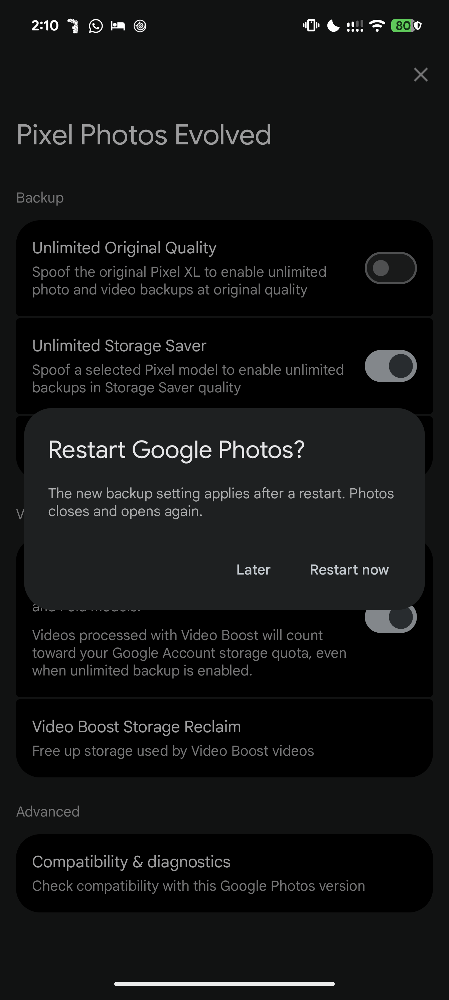

# Languages and device performance — 1.5.0-dev / 36

Checked 30 October 2026 on Pixel 8 Pro, Android 17, Google Photos 7.98.0.1007591100, Vector 2.2.

## Languages

PPE's UI is now available in English, 简体中文, 繁體中文, Español, Português, Русский, 日本語, 한국어,
Bahasa Indonesia and Bahasa Melayu. The module follows the phone language, or the per-app language
set for Google Photos.

**How it works:**
- Every visible string constant in the module (306 call sites, 211 distinct strings) now goes through
  a small getter. The getter looks up a standard Android string resource in the module APK.
- The APK is located with `XposedInterface.getModuleApplicationInfo()` and read with Photos'
  configuration, so Android chooses the language.
- English is the default (`module/res/values/ui_strings.xml`). Each language has
  `module/res/values-*/strings.xml`. A missing key shows the English text.
- The module description in the Xposed manager is translated too.

**What stays in English:**
- log messages;
- the Pixel model names;
- the "Google Photos" version row in diagnostics;
- the "Video Boost" product name.

Some labels are built from pieces (for example "Video 1 of 3"). Their translations were chosen so the
pieces still read naturally, using "1 / 3" in Chinese, Japanese and Korean.

### Fixed along the way: profile card in non-English Photos

PPE places its card above Photos' "Your data in Google Photos" row by matching that row's text, and
the match used the English text. In any other Photos language the card never appeared.

Photos builds that label from the format string `og_privacy_advisor` ("Your data in %1$s"), not from
the page title resource. The hook now matches the format's prefix and suffix in Photos' current
language. It was checked in English, Simplified Chinese and Japanese.

## Device performance

The logs were pulled from a cold start plus navigation through settings, Reclaim and diagnostics.
There were no crashes or module warnings. Four costs were found and fixed. None of the fixes changes
what the user sees or what Photos sends.

| Finding | Before | After |
|---|---|---|
| DexKit compatibility scan at every start (a second `libdexkit.so` load plus a full scan of the Photos APK) | 586 ms CPU on a background thread, during Photos' launch | Skipped when every symbol resolved. Its results were then never shown or used. It still runs when the backend is off, where diagnostics need it |
| Policy executable forked for every backup probe and classification | about 100 ms and one process per call; 3+ probes per start | Results memoized per process (pure 11-byte to 2-byte function; failures are not cached). Repeat probes take 3–8 ms |
| `TextView.onAttachedToWindow` hook called `Resources.getIdentifier` for every TextView Photos attached, on the main thread | one string-keyed resource lookup per attach, including while scrolling | ID resolved once per process. The hot path is now an int compare with no lookup or allocation |
| Translated strings | (new) | Resolved once per process, then served from a map |

These were already lean and are unchanged: the system-property and system-feature hooks (one hash
lookup each, no allocation), the router hooks and the symbol cache (1–2 ms).

### Cold-start A/B

Android won't downgrade the module, so 1.4.1 was rebuilt unchanged as versionCode 35 and 1.5.0 was
shipped as versionCode 36. Both then installed as upgrades. Each build ran 10 launches that Android
reported as `LaunchState: COLD`, all with a valid symbol cache. Warm launches were retried, not
counted. Photos CPU is utime + stime of the Photos process 8 s after launch.

| Metric | 1.4.1 | 1.5.0 | Difference |
|---|---:|---:|---|
| Photos CPU in the first 8 s | 16.04 s (sd 0.40) | 14.87 s (sd 0.43) | −1.17 s (−7.3%), well outside run-to-run noise |
| Launch time (`am start -W` TotalTime) | 884 ms (sd 54) | 876 ms (sd 41) | within noise |
| Photos PSS after 8 s | 465 MB (sd 11) | 459 MB (sd 21) | within noise |
| DexKit compatibility scan ran | 10 of 10 | 0 of 10 | |

The scan ran on a background thread, so removing it saves CPU and battery but doesn't shorten the time
to the first frame. Raw data: [ab-cold-start-1.5.0.jsonl](ab-cold-start-1.5.0.jsonl).

## Restart now

PPE applies the backup identity once, when Photos starts. Photos then caches what it read (Pixel
offer, upload client details), so switching identity inside a running process could leave Photos
half-switched. Instead, a change to Unlimited Original Quality, Unlimited Storage Saver or the Pixel
model asks: **Restart Google Photos?** with **Later** and **Restart now**.

**Restart now** relaunches Photos' launcher activity as a new task and ends the current process.
While a Reclaim job or scan is running, PPE keeps the previous toast instead, so a restart never
interrupts that work.

**Checked on the device:**
- Original → Storage Saver → Original, using Restart now each time. A new Photos process reached the
  home screen within 5 s, the reported identity changed to Pixel 5 and then back to Pixel XL, and the
  backup probe passed after each restart.
- **Later** keeps the same process and only saves the setting.
- The settings were restored afterwards.

After the restart Photos opens on its home screen, not on the PPE page.

## Limits

- A language change applies the next time Photos starts (strings are cached per process).
- The lock-screen/SystemUI and subject-segmentation priorities in the request don't apply to this
  module, which runs only inside Google Photos.
- Translations were written for this release and have not been reviewed by native speakers.
